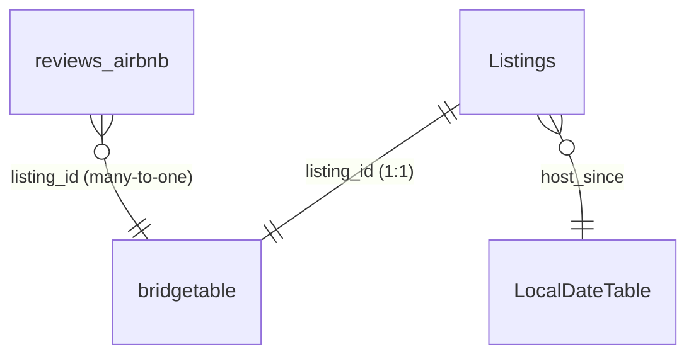

<div align="center">

# 🏠 Global Airbnb Performance Dashboard

**A 3-page Power BI report that turns Airbnb listings, ratings and reviews into a market story: who dominates, who delights guests, when demand peaks, and how far hosts can be trusted.**


[▶ Interactive report](ADD_LINK) · [📄 PDF export](docs/Airbnb_Dashboard.pdf)

</div>

---

## 📸 Preview

| Overview | Ratings | Reviews |
|:---:|:---:|:---:|
|  |  |  |

## 🎯 Business questions

1. How did listing supply grow over time, and which room types drove it?
2. Which cities concentrate the market?
3. Where are guests happiest, and which rating dimensions drag scores down?
4. How concentrated is reviewer activity, and when does demand peak in each city?
5. How trustworthy is the host base?

## 🔍 Key findings

- **Market concentration:** Paris, New York and Sydney together account for almost half of all listings and **48% of all reviews**. Paris leads on both.
- **Guest satisfaction:** Mexico City and Rio are the best-rated cities; Hong Kong and Istanbul rate lowest. **Cleanliness** and **value for money** are the weakest sub-scores across most markets.
- **Reviewer behaviour:** Most guests review once. **98.8% of reviewers wrote three reviews or fewer.** One reviewer logged 283, flagged as an outlier worth validating (data error or globetrotter?).
- **Seasonality:** Paris and Rome dominate review share from April to August; New York climbs in November and December.
- **Trust:** Over two-thirds of hosts are fully verified (identity plus profile photo), and nearly all show at least one trust signal.

## 🧭 Dashboard walkthrough

**1 · Overview.** A KPI strip (listings, cities, hosts, property types, reviews) sits above a listing-growth timeline by the year hosts joined, split by room type (entire place, private room, hotel room, shared room) and annotated with lifecycle phases: *Introduction → Take-off → Growth → Saturation → Decline → Reinvention → COVID era*. A year-range slicer filters the view.

**2 · Ratings.** Market share by city (superhost vs non-superhost listings with a cumulative-% Pareto line), average price by room type, and city ratings with a bookmark-driven **Overall ↔ Detailed** toggle that swaps the headline score for a matrix of five sub-scores: accuracy, cleanliness, communication, location and value.

**3 · Reviews.** A review-frequency distribution (reviewers by number of reviews written, plus a cumulative-% curve), a ribbon chart of each city's share of monthly reviews, and a host-trust panel that segments hosts by identity verification × profile photo.

## 🧩 What this project demonstrates

| Skill | Evidence in this project |
|---|---|
| Data modelling | Multi-table model (listings, listing metrics, reviews), 1:1 and many-to-one relationships, auto date table, dedicated measures table |
| Advanced DAX | 32 measures using `CALCULATE`, `RANKX`, `VAR / RETURN`, `FILTER / ALL`, `ALLSELECTED`, `DIVIDE`, `DISTINCTCOUNT` |
| Analytical techniques | Pareto / cumulative share, 2×2 segmentation, seasonality analysis, outlier flagging |
| Dashboard UX | Narrative page flow, bookmark toggles, slicers, cross-filtering, consistent branding |
| Data preparation | Power Query / Microsoft Fabric Dataflow Gen2, T-SQL type conversion and clean-up |

## 🗄️ Data model



| Table | Grain | Holds |
|---|---|---|
| `Listings` | 1 row per listing | 22 attributes: city, neighbourhood, property and room type, host profile, superhost flag, identity / profile-photo verification, `host_since` |
| `bridgetable` | 1 row per listing | price, minimum / maximum nights, 7 review-score dimensions, instant-bookable flag |
| `reviews_airbnb` | 1 row per review | review_id, listing_id, date, reviewer_id, plus engineered `Reviews per reviewer` and `Review Month` |
| `Measures Table` | n/a | 32 DAX measures grouped by theme: counts, ratios, Pareto, trust segmentation |

## 🧮 DAX highlights

**Pareto: cumulative share of listings by city**

```dax
City Rank =
RANKX ( ALL ( Listings[city] ), [Total Listings], , DESC )

Cumulative Listings =
VAR CurrentRank = MAXX ( VALUES ( Listings[city] ), [City Rank] )
RETURN
    CALCULATE (
        [Total Listings],
        FILTER ( ALL ( Listings[city] ), [City Rank] <= CurrentRank )
    )

Cumulative % =
DIVIDE ( [Cumulative Listings], CALCULATE ( [Total Listings], ALL ( Listings[city] ) ) )
```

**Seasonality: each city's share of a month's reviews**

```dax
% of Monthly Reviews =
DIVIDE (
    [Total Reviews],
    CALCULATE ( [Total Reviews], ALLSELECTED ( Listings[city] ) )
)
```

**Host trust: identity verification × profile photo (one of four segment measures)**

```dax
Verified Profile % =
DIVIDE (
    CALCULATE (
        [Hosts],
        Listings[host_identity_verified] = "t",
        Listings[host_has_profile_pic] = "t"
    ),
    [Hosts]
)
```

## ⚠️ Notes & limitations

- The data is a point-in-time snapshot of listings, so the growth timeline reflects hosts still active at extraction, not total Airbnb supply.

## 🚀 Next steps

- Normalise prices to a single currency and compare medians rather than means
- Consolidate listing attributes and metrics into one dimension table with a dedicated Date table
- Add a neighbourhood-level map and a price-vs-rating view
- Publish to a Fabric / Power BI Service workspace with scheduled refresh

## 📁 Repository structure

```text
├── Airbnb_Dashboard.pbix        # Power BI report
├── README.md
├── images/                      # page screenshots used above
│   ├── 01-overview.png
│   ├── 02-ratings.png
│   └── 03-reviews.png
└── docs/
    └── Airbnb_Dashboard.pdf     # PDF export of the 3 report pages
```

## ▶️ Open it

1. Install Power BI Desktop (free, Windows).
2. Download `Airbnb_Dashboard.pbix` from this repo and open it.
3. Source data: [dataset link and credit](ADD_LINK)

## 👤 About the author

**Shubham Kumar** is an aspiring Business / Data Analyst moving from airline ticketing and travel operations (Sabre GDS) into analytics. I read travel data like an operator: concentration, seasonality, service quality and trust.

📫 Open to Data Analyst, Business Analyst and Power BI Developer roles. [Connect on LinkedIn](ADD_LINK)
